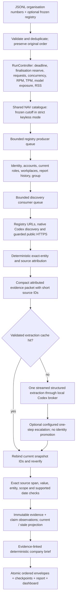

# Signalpost execution architecture

Current local execution uses `--keyless`: the existing Codex subscription supplies native search and compact Luna extraction; public registries and guarded unauthenticated HTML supply preserved evidence. External provider keys and NAV bearer-token requests are disabled. Both fresh 100/1,000 acquisitions finished; three incomplete native receipts keep the larger run's exact cost and full-source gate unresolved. See [the final keyless verification report](KEYLESS_VERIFICATION.md) for measurements, bounded recovery, frozen NAV cutoff and official-evaluator limitations. Earlier Exa-backed measurements below remain historical evidence.

This document describes the implemented runner. Full-discovery 100-company measurements are under `out/architecture-fresh-20261016-v6/100/`. Explicit provider-outage verification uses `out/architecture-fresh-20261016-v7/`. That earlier Exa-backed 1,000-company attempt was blocked by upstream credits; the later keyless acquisition completed separately. Planned limits, outage measurements and historical benchmarks must not be presented as interchangeable.



## Boundaries and retained behavior

`src/cli.ts` owns execution. Registry collection and company research overlap through a bounded pipeline (`src/runtime.ts`). Only the original input order controls final output. Duplicate input rows share research and retain their original output positions. A missing row in supplied frozen identity never silently resolves from live identity. Every valid supplied identifier receives an honest terminal envelope even when admission is closed or sources fail. The CLI still supports registry-only, fictional demo, existing Eve tools, API and gateway providers, and previous-snapshot comparison.

Publication distinguishes company hosts, entity-specific pages on shared/brand hosts and permitted third-party records. A scoped page cannot promote a parent root. Generic portfolio/index/signup pages, ambiguous footer mentions and sector directories cannot establish ownership; legal boilerplate is not a business description. Postal contacts, area descriptions and property-portfolio values retain qualifiers and do not inflate operating-location coverage. Claim histories retain the validation-policy version and flag legacy stale claims requiring re-verification.

Existing financial normalization, exact-org directory attribution, franchise/group exclusions, NAV employer/subunit matching, outbound social-profile verification, robots checks, DNS-pinned HTTPS, immutable source text, and uncertain paid-call protection remain in place. Account-level Exa blocks suppress further work through the existing provider circuit. Unpaid registry retries are bounded; observed Retry-After headers delay subsequent admission to that host. Annual-report history retains its self-imposed 2.1-second pacing. This alone adds about 35 minutes for 1,000 history requests; it is an application policy, not a verified provider-mandated minimum.

A finalisation reserve stops new work before the batch deadline. Cancellation reaches queued network admissions, HTTP bodies and the model stream. The global physical-request ledger counts requests made by this runner, including redirects, robots and shared-source setup. The authenticated local relay shares the global network pool instead of the public publisher per-host cap; its dispatcher separately bounds connected tool concurrency. Connected Exa upstream crawls and model-provider protocol requests are **outside** that physical count: source operations/tool calls and model usage are reported separately. RSS admission measures runner RSS; sampled process-tree RSS is an observation, not a hard operating-system memory limit. Filesystem exhaustion or process termination before finalisation can still prevent a final file; checkpoints and the SQLite ledger preserve completed work.

## Models and measured cost

The compact transport is default. It uses Eve's supported `chatgpt` adapter and the existing Codex app-server login broker. No auth-file copying, new API key, agent shell or unrestricted loop is used. Extraction has no browsing tools. Optional keyless discovery uses a separate bounded native-search call through the same subscription; candidates still require direct public retrieval and exact-entity verification. See [keyless verification](KEYLESS_VERIFICATION.md) for its guards, cost accounting and evaluator-authentication limitation. The primary is `gpt-6-luna`; attributed packets are bounded by bytes and each output is structured, extractive, then independently checked by code. No attributable evidence means no model call.

Default packet / streamed output bounds are 16,000 / 14,000 bytes, model timeout 30 seconds, zero SDK retries, and a requested 2,048 output-token cap. The subscription backend strips the provider output-token cap; only the local streamed-byte/time boundaries are claimed for that transport. A durable pending attempt is written before external inference; resume cannot automatically repeat an uncertain/completed attempt without a saved final extraction. A terminated request may have incomplete provider usage; retain its conservative reservation and report unknown actual equivalent cost. Short source IDs avoid model copying of UUIDs. Public activity requires an explicit supported calendar date. Untrusted source passages never confer instructions or permission.

`SIGNALPOST_ESCALATION_MODEL` and `SIGNALPOST_ESCALATION_PROVIDER` enable at most one configured escalation on an attributed packet with no accepted primary claims and sufficient time. Escalation is disabled by default until paired evaluation demonstrates a benefit. Haiku, Sonnet and GLM price presets exist as configuration options, not as measured winners. Unknown models require explicit prices. No model comparison is claimed without a matched source/label evaluation.

`src/pricing.ts` records each completed call's actual inclusive input/output, cache read/write and reasoning tokens, provider/model ID and its dated rate card. Subtract cached reads/writes from inclusive ordinary input exactly once. API equivalent uses those token counts and the verified rate card; it is not the subscription bill. Luna's small-prompt standard rates as checked 16 October 2026 are $0.10 ordinary input, $0.01 cache reads, $0.125 cache writes and $0.50 output per million tokens ([official model page](https://developers.openai.com/api/docs/models/gpt-6-luna)). The local fixed subscription is excluded; incremental model API charge is zero. Connected Exa dollars are unknown, never zero. Alternate providers may report or require configured actual rates. Account credits, subscription capacity and upstream provider quotas remain external constraints. Inspect durable attempts without changing them with `node --import tsx scripts/inspect-model-attempts.ts --db out/RUN/store.sqlite`.

Admission reserves conservative byte-derived model exposure before a call, then replaces it with measured equivalent cost on completion. Resource admission is transactional in SQLite across workers. `--max-model-equivalent-usd` controls model exposure separately from existing Exa reservations. Incomplete model calls keep reservations and make the aggregate equivalent cost unknown; the ledger remains an upper exposure estimate, not fabricated token usage.

## Cache and refresh correctness

`src/cache.ts` stores immutable compressed content-addressed raw response text with retrieval metadata, ETag/Last-Modified and redirect observations. In-run duplicate GETs coalesce. A subsequent run conditionally revalidates; a 304 reuses bytes with a new observation time. Failed GETs do not create persistent absence. Byte ceilings are 4 MB normally and 16 MB for the official NAV feed host. Provider-normalised text and original HTTP raw text have separate hashes; the published evidence hash covers the preserved evidence snapshot.

Model extraction cache keys include exact company identity/proof, source URLs/hashes, packet contents, prompt/extractor version, attribution policy, model/provider, output boundary and cutoff. A hit still maps current source references and reruns claim verification. The optional event-date cutoff scopes caches and explicit dated claims; it is not a historical web archive and cannot establish past facts from undated current pages. Strict historical as-of evaluation needs archived snapshots. No old company profile is a discovery answer for a fresh benchmark. Shared NAV source reuse is declared independently of cold company, HTTP and extraction state.

`src/claim-ledger.ts` keeps stable fact keys, immutable per-run observations and current projections. Period/scope/source and multi-claim discriminators separate unlike facts. Complementary claims under one stable source key are consolidated losslessly with their evidence before persisting an observation. Unchanged supported values stay unchanged when hashes or retrieval timestamps change. Changed interpretation of unchanged evidence is a processing correction. A temporarily unestablished fact remains historical/stale; it is not published as current truth or converted to absence. Existing source-backed material-change comparisons remain available. `synthesis` is a deterministic evidence-linked summary of current supported claims, with unknown fields visible, rather than an extra generative call.

## Local controls

```sh
npm run batch -- --keyless --organisations companies.jsonl --output out/new/results.jsonl \
  --db out/new/store.sqlite --run-id NEW_RUN \
  --model-transport compact --workers 8 --registry-workers 12 \
  --network-workers 24 --per-host-workers 3 \
  --model-rpm 120 --model-tpm 2000000 \
  --max-model-equivalent-usd 10 --max-requests 50000 \
  --max-rss-mib 2048 --finalization-seconds 15 \
  --company-timeout-seconds 210 --timeout-seconds 7200
```

These are application test limits, not official challenge limits. Configure the evaluator's actual constraints. `--no-model` is a deterministic ablation, not the complete default behavior. `--skip-nav` explicitly excludes that source. `--model-transport eve` retains the older bounded tool path for comparison. Cache locations are explicit with `--cache`; otherwise each output directory has its own cache.

## Verification before release

`tests/runtime.test.ts`, `cache.test.ts`, `compact-model.test.ts`, `claim-ledger.test.ts` supplement the retained source/identity/financial/refresh tests. Typecheck plus the full suite are required before freezing a live runtime. No paid alternate-provider smoke test is implied.

```sh
python3 scripts/select-fresh.py --output out/NEW_FRESH_SELECTION
node --import tsx scripts/run-fresh.ts --directory out/NEW_FRESH_SELECTION --size 100 --transport codex
node --import tsx scripts/verify-fresh.ts --directory out/NEW_FRESH_SELECTION --size 100
node --import tsx scripts/run-fresh.ts --directory out/NEW_FRESH_SELECTION --size 1000 --transport codex
node --import tsx scripts/verify-fresh.ts --directory out/NEW_FRESH_SELECTION --size 1000
```

The selector freezes 1,100 random previously unseen identifiers with a seed, universe/input hashes, exclusion inventory and zero cross-batch company overlap. Shared host overlap is observed after discovery, not promised from bare identifiers. The runner rejects an existing output directory and freezes source/package/UI/relay fingerprints across batches. The final wrapper uses the production six-search/twelve-content-page/four-result policy, with 16 research workers for each strict keyless batch (older Exa modes used 32 for 1,000) and a 300-second active company budget. NAV zero observations do not suppress independent careers discovery; attributed sites also receive a dated activity lookup when time and search admission remain. Larger search budgets might still improve independently measured recall. Both start empty company/HTTP/extraction state; the shared NAV mode and setup time remain explicit. For the already connected local Exa transport, use `--transport connector --relay-access out/RELAY/access.json` and its live dispatcher; this path is a local research adapter, not a standalone evaluator dependency. The earlier configurable evaluator path uses evaluator-supplied API credentials. The current strict keyless route requires confirmation of organizer-supported authentication before an official portability claim.

`verify-fresh.ts` audits a SQLite backup, never repairs the original result, and checks input/output order, terminal count, hashes, frozen runtime, source spans, financial values/scope/period/currency, resource limits and exact-entity claim verifier. Audit artifacts distinguish mechanical consistency from independent semantic precision. A passing local audit is not the organiser's 65/100 qualification or measured recall.

Release evidence must include the 100/1,000 reports, source failure taxonomy, real model calls/tokens/equivalent cost (or explicit incomplete usage), p50/p95/p99 stage queue and execution times, total wrapper wall time (including final output/report work), cache counts, physical and logical requests, shared-source mode/setup, coverage by field, retained output hashes and independent claim review. A production decision must also use labelled precision/recall, adversarial wrong-entity cases and matched no-model/model ablations; mechanical self-checks cannot substitute for those labels. Source scarcity must not be hidden with hallucinated facts. No smoke outputs or model cache may be loaded as answers for an official held-out batch.

## Challenge traceability

| Challenge area | Implementation and review evidence |
| --- | --- |
| 50% coverage/recall | Registry, financial history, roles, workplaces, exact-org shared NAV, deterministic source discovery and bounded extraction; field availability reported; independently labelled recall still required |
| 30% precision/evidence | Exact source spans/hashes, value/date/entity/scope checks, group/franchise exclusions, mechanical source audit and preserved raw evidence |
| 12% synthesis | Current supported company brief with per-section evidence, unknowns, history and financial scope retained |
| 8% UX | Existing searchable live dashboard, financial comparison/scope/year, coverage filters, source viewer/export; new API-equivalent/latency disclosure, company brief and freshness history |
| Batch/evaluator contract | Arbitrary batches, frozen identity option, ordered terminal envelopes, explicit availability, portable API/gateway path, one command, no submission implied |
| Efficiency and recovery | Bounded pipeline, shared admission/quotas, deadline propagation, conditional cache, compact one-call model path, atomic output/checkpoints, unknown cost preservation |

Known account outages can be declared with `SIGNALPOST_EXA_BLOCKED_REASON`; this blocks Exa before admission while preserving direct-source fallbacks and honest blocked fields. The fresh wrapper accepts `--source-block-receipt PATH` only for a retained actual connector HTTP 402 receipt, hashes that proof, and labels the measurement `provider_outage_failure_mode`. It sends no Exa requests and cannot establish full-source scale performance. Remove the explicit preflight block only after source access is restored; a quota block must never be silently reset by changing companies or restarting a worker. Application research workers are capped at 64; the frozen 1,000-company outage test requests 32, and the actual count is included in the report.
