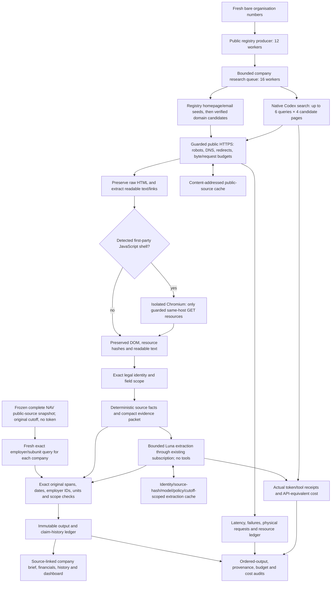

# Keyless discovery and verification

**Subsequent semantic audit:** see [Semantic verification](SEMANTIC_VERIFICATION.md). Original mechanical measurements below remain preserved. Independent source-context review found 30 unsupported and 33 ambiguous external strings; complete corrected accuracy/recall is not established. The subscription admission guard is active after HTTP 429/no-output calls; do not start new discovery or model calls while it remains active.

**Current status:** both fresh acquisitions finished without external API keys or purchases. The 100-company run passes all recorded local gates. The 1,000-company output passes mechanical checks, while three incomplete native usage records keep its complete-cost/full-source gate unresolved. Independent semantic accuracy, exhaustive recall and official-evaluator portability are not established.

The local route uses public Norwegian registries and NAV, the existing Codex/ChatGPT subscription for native live-search candidate discovery and compact extraction, and direct unauthenticated HTTPS retrieval for evidence. Exa, Firecrawl, external MCP services and private third-party API credentials are excluded. The final strict keyless mode also forbids NAV's publicly issued bearer token. It reuses the already collected complete public-source catalogue at its unchanged cutoff (2026-10-16T17:24:14.516Z), makes no token request, and never describes that snapshot as a live current sweep. Public job pages remain available through live discovery. Missing frozen catalogue state is an explicit unavailable source, not a fabricated empty result. Earlier development runs allowed NAV's public token; they are not evidence of the final strict boundary. Company website retrieval is unauthenticated. Native search is an existing subscription capability, not an unlimited free independent search engine.

## Execution boundary

`npm run batch -- --keyless --organisations companies.jsonl ...` skips `.env`/`.env.local`, removes keyed-provider/relay credentials from the process, forces `chatgpt` / `gpt-6-luna` and the `codex` source transport, disables configured escalation, and requires the compact model transport. The subscription model exposes only the native hosted web-search tool for discovery; extraction has no tools. No general agent, shell tool, connector or delegated agent performs research. A pinned Playwright Core dependency can render detected first-party JavaScript shells in isolated Chromium contexts; it does not use a logged-in browser profile. Chromium must be installed (`npx playwright-core install chromium`) or supplied with `SIGNALPOST_CHROMIUM_PATH`. Existing local Chrome is detected on macOS.

The source-depth allowance preserves six search queries with up to four directly retrieved result pages each, plus the separate 12 follow-up pages; direct search-result retrieval does not consume that follow-up allowance. Physical public HTTP requests still share the global budget.

Search queries retain the production website/identity/hiring/profile/activity intents. Only URL sources returned by the native tool can become candidates. Generated prose, snippets and model-provided quotes cannot enter the evidence store. At most two deterministic Norwegian domain guesses per company supplement registry homepage/email seeds; a guessed hostname never proves ownership. Registry seeds run first and successful attribution skips extra guesses.

Candidate pages must pass the existing public DNS, HTTPS, robots, redirect, byte and concurrency checks. Raw HTML is preserved, readable text is derived from it, and the existing exact-company, field-scope, quote and date checks still gate publication. Restricted social platforms are represented only by verified outbound links from permitted sources.

Search calls have a 45-second local deadline, no SDK retries, a 256 KB stream limit and local abort on an additional tool call; a multi-query/action policy violation is rejected. The subscription endpoint rejects `max_tool_calls`, so this is **not a provider-enforced hard remote tool-call cap**. A cancelled or interrupted response may have unreported usage, which stays unknown and retains conservative resource exposure. Rendering is limited to detected JavaScript shells on plausible company brand hosts, with two contexts at most, a 20-second local deadline, 30 admitted resources and 8 MB total source text. Every browser request is fulfilled through the guarded public GET transport; other hosts, non-GET requests, authorization, key/token queries, media, service workers and WebSockets are blocked. Original HTML, rendered DOM, input/resource hashes and readable extraction remain separate. Browser output still needs the same legal identity checks.

Raw HTML is excluded from ownership corroboration; its separately preserved readable extraction supplies the evidence. Unparsed runtime-script bytes cannot authenticate a page. Explicitly parsed publisher structured data follows its own provenance checks. This also reduces repeated raw-byte scans.

Typed account/configuration access failures stop further native discovery rather than draining the batch through a known unavailable provider. TPM admission reserves conservatively while a call is in flight and settles to reported token usage on completion; uncertain calls retain their reservation.

Completed calls retain provider IDs, actual token usage, tool count, queries and candidate URLs. Do not equate an SDK request count with all internal search-engine requests.

## Cost and latency

Actual incremental external API billing is zero in keyless mode; the existing subscription fee, its capacity consumption, machine/network costs and developer/operator research are separate. Model API-equivalent cost uses actual reported inclusive token usage and cache reads. Native web-search API-equivalent tool cost is reported separately at $0.01 per call, plus the model tokens already counted; it is not an Exa bill. Combined equivalent cost is model plus search-tool equivalent cost, and is unknown when usage is incomplete. A six-search/company ceiling corresponds to at most 6,000 intended calls for 1,000 companies, or a $60 search-tool list-price scenario before model tokens, not a prediction of the actual subscription charge. Admission limits must account for both resources.

The initial CLI probe used about 19.8 seconds and 73,566 input tokens for two tool calls. The compact SDK probe used about 6.3 seconds and 8,539 input tokens for one call. These are individual probes, not scale estimates. Quantiles, actual source failures and queue times must come from the completed batch. Public source and derived extraction caching retain the existing identity/hash/policy/cutoff scoping and do not reuse old company answers for a fresh benchmark.

## Validation sequence

1. Unit/integration checks verify credential removal, source transport lock, no Exa fallthrough, robots denial, preserved direct HTML, source receipts, deduplication and separate token/tool accounting.
2. A matched development run re-researches the previous 100-company full-source baseline into a new database. Compare every baseline positive by company and field; a higher total count cannot hide lost positives. Preserve failures and inspect lost and gained fields against current source bytes. This is not a fresh holdout or independently labelled precision/recall measurement.
3. Only after reviewing the paired results, freeze code and select a new disjoint 100 + 1,000 bare-ID holdout. Keep failed/stopped attempts as diagnostics. Check ordered output, immutable evidence, raw-to-text provenance, entity/quote/date/financial consistency, budgets and every source failure. State unavailable fields and source restrictions explicitly.
4. Challenge qualification, exact-company/factual precision, recall, false-change rate and noninferiority require independent reference labels or the organizer's harness. Coverage and mechanical evidence-span checks cannot establish these by themselves.

## Challenge portability boundary

The official playbook permits LLMs and does not mandate Exa. It also says the evaluator cannot use a credential tied to the entrant's own account on another service. The local Codex subscription route therefore **does not by itself establish clean official-evaluator reproducibility**. Do not package, export or share personal subscription credentials. A separately confirmed organizer-supported authentication/runtime arrangement would be needed for the same native-search backend; no such arrangement has been established here. An entirely unauthenticated registry/crawler fallback is possible, but its broad-discovery coverage is not established as equivalent and must not silently replace native search during scoring.

## Rejected discovery substitutes

A direct DuckDuckGo HTML probe returned a challenge (HTTP 202); no CAPTCHA bypass, proxy, user-agent disguise or endpoint rotation is used. Other search front ends with disallowed search paths are excluded. Public SearXNG instances are upstream metasearch relays, not a guarantee of independent unrestricted capacity. Common Crawl is useful for historical URL discovery but does not replace live company-name search or current source evidence. Norid anonymous RDAP cannot enumerate an organization's domains; reverse organization searches require registrar authentication. Wikidata's Norwegian organization-number/official-website mappings may supplement seeds, but their coverage has not been measured here.

Sources: [challenge harness](https://builderr.ai/docs/signalpost-evaluation-harness.md), [agent playbook](https://builderr.ai/starter-briefs/signalpost-agent-playbook.md), [source policy](https://builderr.ai/starter-briefs/signalpost-sources.md), [Codex web search](https://learn.chatgpt.com/docs/web-search), [OpenAI tool pricing](https://developers.openai.com/api/docs/pricing), [Norid RDAP](https://teknisk.norid.no/en/integrere-mot-norid/rdap-tjenesten/), [Common Crawl index](https://index.commoncrawl.org/), [SearXNG search API](https://docs.searxng.org/dev/search_api.html).

The first completed native-search comparison (`out/keyless-paired-100-v3`) took 678,546 ms with 482 completed search tools, no failed searches, model equivalent $0.2786471 and search-tool equivalent $4.82. Its 12 websites versus the prior 17, and 21 lost company-field positives, failed the retention gate. It is a development result, not an accepted replacement. Subsequent fixes were driven by source-level evidence: footer-address packet clipping, missing domain candidates, and real JavaScript shells. These must be evaluated again before a fresh scale claim.

The second completed comparison (`out/keyless-paired-100-v4`) took 544,153 ms, with 478 native search calls, no failed searches, model equivalent $0.27588968, search equivalent $4.78 and 16/17 baseline websites retained. It still failed raw retention (10 lost company-field positives), so it is preserved as development evidence. Exact whitespace anchoring, complete HTML entity decoding, and targeted staffing-state extraction were added only after reviewing these concrete losses. A per-job snapshot index replaces corpus-wide scans; a local-copy query-plan check preserved identical ordered rows.

The prior Uvdal hiring information refers to an advert published 7 July 2026 with “Søk senest fredag 31. juli”. At the 16 October cutoff this cannot establish current hiring. The new validator rejects that uncertain yearless deadline without inventing an expiry date. Raw baseline retention and reviewed current-fact retention must be shown separately; this exclusion cannot be hidden as an overall coverage gain. Historical public-activity claims retain their actual event dates and are not labelled recent merely because the page was retrieved today.

The frozen source-acquisition publication policy was `signalpost-scope/20261016-v4`; the separately tested final processing policy is `signalpost-scope/20261017-v5`. Direct readable HTML uses `public-html-text-and-links/v3`; readable rendered DOM uses `public-rendered-text-and-links/v2`. Both retain original raw artifacts. Whitespace re-anchoring selects real source substrings and never changes words, punctuation or numbers; normal exact-span and identity validation still runs afterward. Full HTML entity decoding preserves Norwegian letters, non-breaking spaces and hexadecimal references before readable-source hashing.


## Final development gate and strict credential boundary

The last live paired acquisition (`out/keyless-paired-100-v5`) completed 100 development companies in 484,832 ms, with 476 native search calls and complete reported usage. Model equivalent was $0.27418718 and search-tool equivalent $4.76, combined $5.03418718. It recovered all 17 baseline websites, but still lost three company-field positives. It is not the accepted fresh scale measurement.

Inspection found overlapping excerpt windows dropping actual address/business text, address punctuation added by extraction, harmless Facebook tracking parameters, and mixed expired vacancies/open-application policies. Window merging now preserves the actual source statements; deterministic whitespace/address selection returns only original text. Company-owned open applications and fully staffed statements remain separate from current vacancies. The Norwegian `jobb-hos-oss` careers path is included. An expired July vacancy stays rejected.

Two saved-source extraction replays isolated processing from discovery. The final policy replay (`out/keyless-extraction-replay-100-v7/final-careers-policy-replay.json`) processed all 100 saved companies on a copy with zero model/network calls and unchanged originals. It retained 17 websites, 17 business descriptions, 15 locations, 10 profile-link fields and four hiring-information fields, covering every previously populated company-field pair. These are field-presence comparisons, not complete individual-fact recall or semantic noninferiority. Replay duration is not fresh end-to-end latency.

The frozen fresh holdout excludes 7,811 previously encountered identifiers and contains disjoint batches of 100 and 1,000 companies, with independently recomputed zero overlap. Final strict keyless execution reuses the declared NAV snapshot without any external bearer token. Model/search usage is charged only as API-equivalent measurement against the existing subscription; no external API credit purchase is authorized.


## Fresh strict-keyless 100-company result

Frozen batch: `out/architecture-keyless-fresh-20261016-v1/100`. All 100 ordered terminal envelopes were produced with no failed company envelope; all remain partial because some requested evidence is unresolved. Wall time including process startup was 519,417 ms (8m 39.417s). The runtime fingerprints were unchanged. The mechanical audit, source/raw-HTML provenance checks, budgets and strict keyless-route checks pass. All 467 native search operations completed with usage receipts; no prohibited provider receipts, external token requests or missing raw source artifacts were found.

Model equivalent: $0.27147746, native search-tool equivalent: $4.67, combined: **$4.94147746**, excluding the existing fixed subscription fee and local machine/operator costs. Reported usage: 4,238,230 input tokens and 28,859 output tokens; API-equivalent pricing accounts for provider-reported cache reads. Native search latency p50/p95 was 5,641/10,563 ms. Physical public requests: 2,366. Main-process maximum RSS: 736,512 KiB.

Populated coverage: 100 financial-account collections, 100 leadership collections, 100 report histories, 81 revenue values, 79 registered-workplace collections, 24 verified websites, 22 business descriptions, 19 location fields, ten company-profile-link fields, one recruitment-information field and one **historical** public-activity field. These counts are not recall. A NAV source query was derived independently for all 100 against the declared 17:24 UTC snapshot; no current all-NAV sweep is claimed. The one activity describes an event on 18 November 2022. The recruitment excerpt invites applications for a project leader and related roles, without establishing a current vacancy count.

Assisted source review included an entity-specific Toyota Hamar page and a separately scoped online shop rather than attributing their parent hosts globally; the EgdePlan activity preserves its 2022 date. Mechanical checks and this non-blind development review do not provide an independent semantic accuracy estimate.

The disjoint 1,000-company acquisition has finished. Its results and incomplete-usage gate are recorded below.

## Implemented keyless flow



Search prose and snippets never enter the evidence path. Failed or restricted sources remain unresolved. Cached old company answers are excluded from fresh runs. Source, model and rendering limits are explicit; local cancellation is not represented as a provider-enforced remote billing cap. Independent semantic labels and clean official-evaluator authentication remain separate requirements.

## Scale-run issues retained for review

During the frozen 1,000-company acquisition, two native-search requests returned `Failed to process successful response`. Their original underlying causes and usage receipts were not retained by the SDK-facing code. They remain failed calls with incomplete usage; no token count, search count or zero cost is invented for them. Both exact queries later succeeded in isolated developer probes while subscription access remained available. Those probes are separate artifacts, not replacement receipts for the original calls. The full sweep finished, but it cannot pass the original complete-usage gate while these unknowns remain. A third response returned a provider error with zero search tools and no token usage; it also remains incomplete.

A separate source-level check found a conservative attribution gap for `STIFTINGA VESTLANDSFORSKING`: the saved `/nn` page contains the exact organisation number and matches the registry website, but the matcher did not recognize the formal foundation prefix or Nynorsk language root. The isolated candidate strips `Stiftinga`/`Stiftelsen` only when the official legal-form code is `STI`, recognizes `/nn`, and retains wrong-identifier and non-foundation rejection checks. All 181 final tests, type checking and the production build pass. A zero-network, zero-model replay of the completed fresh 100 retains every published claim and leaves the original output unchanged. The actual held-out foundation source also verifies under the candidate. This is a processing correction, not a new source-acquisition benchmark or independent semantic gold label.

The source-acquisition implementation is archived under `out/architecture-keyless-fresh-20261016-v1/measured-runtime/`: all 58 archived files matched their frozen hashes. Credentials and environment files are excluded. Later presentation/processing changes must remain distinguishable from that measured implementation.


## Completed fresh strict-keyless 1,000-company acquisition

`out/architecture-keyless-fresh-20261016-v1/1000` produced all 1,000 ordered terminal results in **4,356,570 ms (1h 12m 36.570s)**, without stopped admission or a runtime change. Independent freshness checks confirm zero overlap with prior research and between batches. The original output SHA-256 is `24816e5892ceed755778a117337060e09a82181bd4301f73242eb01da49aa062`.

Mechanical evidence, entity, quote and financial checks pass. The strict credential boundary passes: zero prohibited-provider receipts, zero external token requests, zero missing preserved raw artifacts. The source-completeness/usage gate remains **false**: of 4,854 native search attempts, 4,851 have successful one-tool receipts; two failed without saved usage and one returned a provider error without usage. Original incomplete records remain intact. Consequently **the exact model, search and combined API-equivalent totals are unknown**. Known completed model usage is $2.77209228 and known completed search tools are $48.51, a **known subtotal of $51.28209228**. This is neither an exact total nor an upper bound. Subscription fees, machine costs and separate development/recovery probes are excluded.

Reported completed usage is 43,697,942 input and 262,232 output tokens. Completed native-search latency p50/p95 is 5,420/9,227 ms. The runner recorded 23,233 physical public requests and maximum main-process RSS 1,239,744 KiB. It retained 8,428 raw HTML and 8,296 readable HTML snapshots, with source lineage and transport hashes checked.

Populated fields: 998 financial-account collections, 998 leadership collections, 1,000 report histories, 769 revenue values, 766 workplace collections, **118 websites, 99 business descriptions, 94 locations, 41 profile-link fields, 18 hiring-information fields and six dated activity fields**. These are coverage counts; they do not establish recall. Missing annual accounts and financial-normalization warnings remain visible. Activity dates are preserved; retrieval time does not make an old event recent.

The original incomplete native intents concern Urban Sharing AS (920285333), Stiftinga Vestlandsforsking (965919627), and Børsbygg AS (983532527). One bounded successful discovery probe for each exact intent was retained separately. A later processing/recovery output imports those as additional calls, retrieves permitted candidate pages, and rechecks every publication under v5. It cannot retroactively repair the original unknown cost or turn the original fresh audit green.


## Reproduction and artifact boundaries

The preserved original measurements are the `100` and `1000` directories under `out/architecture-keyless-fresh-20261016-v1/`. Their runtime archive, input selection manifest, independent freshness audit, process results, immutable JSONL exports, raw SQLite sources, mechanical audits and strict-route audits are separate artifacts. `comparison.json` summarizes both; `final-validation-summary.json` records the remaining gates. Do not rerun into those paths or resume their failed native calls in place.

For a **new** frozen selection prepared by `scripts/select-fresh.py`, the keyless wrapper commands are:

```sh
node --import tsx scripts/run-fresh.ts --directory out/NEW_SELECTION --size 100 --transport codex
node --import tsx scripts/verify-fresh.ts --directory out/NEW_SELECTION --size 100
node --import tsx scripts/audit-keyless.ts out/NEW_SELECTION/100
# Freeze the same runtime before running the separate size-1000 batch.
```

No new sweep is necessary to review the preserved results. Full caches, credentials, databases and traces stay local and are excluded from release archives. The final application changes were applied with per-file before/after hash checks and original-file backups in `out/keyless-final-application-backup/`; unrelated existing work was preserved. No commit, deployment or challenge submission was performed.


## Latency and coverage limits observed at scale

In the original 1,000-company run, company-job runtime p50/p95 was **234.745/291.221 seconds**, distinct from native-search latency. Web-research execution alone was 65.913/111.376 seconds, with web-queue waiting 142.848/185.983 seconds. These quantiles are separate distributions and must not be added to estimate a percentile. Registry execution was 24.452/39.559 seconds; registry-queue waiting reflects position in the 1,000-company input. The preserved 2.1-second annual-history pacing is self-imposed and contributes about 35 minutes to the batch; it is not a demonstrated provider requirement.

Cold extraction-cache hits were zero; public HTML recorded 5,638 in-run shared observations. No live 304 or warm-cache latency saving is claimed. The frozen NAV query attributed 36 active advertisements to eight companies **at the declared snapshot cutoff**. Thirteen companies had other recruitment information, with overlap; the union is 18, not 21. A zero NAV match does not establish no hiring.

The exact-identity filters and fixed packets can omit valid abbreviated-language descriptions or profile handles. The separate foundation recovery, for example, verifies its website but does not by itself prove that all descriptions, social links or events on the site were extracted. Six queries and bounded pages are measured search depth, not proof of exhaustive internet coverage. No claim of unchanged individual-fact recall, independent semantic precision or challenge qualification is made without external reference labels.


Source-health counters retain their original schema: `successful_fulltext_operations` counts provider Contents calls, so its zero in keyless mode does **not** mean no HTML evidence was retrieved. The independent raw/readable snapshot audit is the relevant direct-HTML measure. Likewise failed registry-call counts include alternate endpoint attempts and expected unavailable years; they are not counts of failed company envelopes. The JSONL availability and per-field errors remain authoritative.


A post-run published-evidence host comparison found zero cross-batch overlap after excluding the named shared registry/feed/directory/recruitment hosts (`host-overlap-review.json`). This narrow check does not prove that every acquired page or every development/validation host is disjoint. The playbook's recommended independently labelled development/validation/final protocol has not been completed here.


## Final v5 recovery and publication checks

`out/keyless-final-reprocessing-1000-v5/` processed all 1,000 saved companies in **571,394 ms (9m 31.394s)**, on a separate database. It made 12 guarded public requests, imported the three separately saved successful native discovery receipts, reused 140 exactly matching completed model packets, and made one bounded new extraction for changed evidence. The processing wall excludes the earlier discovery probes; their actual receipts and costs are imported separately. Original source-collection timing is retained and labelled separately in the dashboard.

Additional known model-token equivalent is $0.00242306 and search-tool equivalent is $0.03. The resulting known cumulative subtotal is **$51.31451534**, while the exact cumulative total remains **unknown** because the original three incomplete responses remain present. External API charges remain $0; fixed subscription and machine costs are excluded.

Every originally available published field/value pair was compared exactly against the new ordered output: **zero lost values**. This measures retention of prior published values, not exhaustive source recall or semantic truth. Coverage is now **119 verified websites and 95 location fields**; business descriptions remain 99, profiles 41, hiring-information fields 18 and activity fields six. Every output remains linked to preserved source bytes; the final policy does not turn unknown employer activity, expired vacancies or historical events into current facts.

The separate 100-company processing check (`out/keyless-final-reprocessing-100-v5/`) took 57,611 ms, made zero new model/network calls, reused 26 exact model packets and retained every prior publication. Its mechanical and strict-route audits pass. Neither processing check is represented as another cold/fresh acquisition, and original outputs remain unchanged.


Final dashboard verification uses an isolated backup at `out/keyless-ui-final/store.sqlite`: all 1,000 profiles pass API inspection, source-hash verification, ordered export, credential isolation and invalid-launch checks. Local-only Chromium checks pass at 1440×1000 and 390×844: brief/history/financials/source viewer, frozen cutoff, incomplete-cost wording and keyless launch labels are present, with no JavaScript errors or horizontal body overflow. Screenshots and `qa.json` are in `out/keyless-ui-final/`. The review dashboard is available locally at http://127.0.0.1:4384 while its process remains running. No valid research launch was submitted during UI testing.


The final v5 offline mechanical audit **passes**: 1,000 ordered outputs, 17,324 evidence references, 2,798 financial records, 18,778 financial amounts compared with preserved source values, and 1,531 web claims revalidated; zero failures, zero withdrawn claims and zero source/model acquisition calls during audit. `verification.json` records this mechanical result. The separate `keyless-audit.json` confirms the credential/provenance boundary while intentionally retaining failed complete-usage gates for the three original native responses. Passing mechanics does not certify independent semantic precision, exhaustive recall or official qualification.
